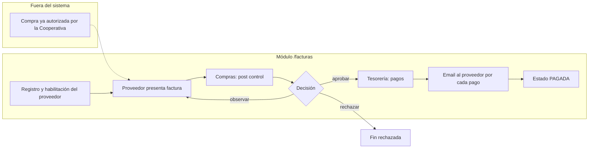

# Módulo de Gestión de Facturas de Proveedores (`/facturas`)

Documento de referencia del trabajo planificado y diseñado dentro de la web institucional de la **Cooperativa Eléctrica San José de la Dormida**. Resume todo lo realizado en la conversación de diseño (Etapas 1 a 3) hasta la fecha.

> **Estado general:** el módulo está **diseñado y endurecido en SQL (Fase B)**, pero **aún no está integrado en Next.js** ni desplegado en UI. Las migraciones **no se ejecutaron en Supabase remoto** (ver [Estado en Supabase](#estado-en-supabase)). Detalle de correcciones: `docs/FASE_B_ENTREGABLES.md`.

---

## Qué es este módulo (y qué no es)

| Concepto | Descripción |
|----------|-------------|
| **Este módulo (`/facturas`, prefijo `fp_`)** | Gestión de **facturas que presentan proveedores** a la Cooperativa: habilitación de proveedores, post control de Compras, pagos en Tesorería, comprobantes y notificaciones por correo. |
| **NO es lo mismo que** | Las **boletas de socios** del chat/WhatsApp (`lib/invoices.ts`, tabla `invoice_requests`, envío desde Google Drive). Ese flujo sigue intacto y debe mantenerse separado en código y en base de datos. |

La **compra** que respalda la factura del proveedor ya fue **autorizada por la Cooperativa fuera de este sistema**. El software comienza cuando el proveedor ya tiene emitida su factura y la presenta en el portal.

---

## Objetivo del proyecto

Desarrollar un sistema integrado a la web existente (Next.js + TypeScript + Supabase) con cinco roles y el circuito:

**Proveedor habilitado → presenta factura → Compras (post control) → aprobar / observar / rechazar → Tesorería → pagos parciales o totales → notificación por correo por cada pago → factura pagada (saldo cero).**

---

## Tecnologías previstas

- **Next.js** (proyecto actual, App Router).
- **TypeScript**.
- **Supabase Auth** (a implementar en etapa posterior; hoy el sitio usa service role + contraseñas en otros módulos admin).
- **Supabase Database** (tablas `fp_*`).
- **Supabase Storage** (bucket privado `fp-documents`).
- **API Routes** de Next.js (etapas futuras).

---

## Circuito administrativo definitivo



### Reglas de negocio clave

- Registro público de proveedores; **habilitación manual** por Compras.
- Orden de compra **opcional** (`fp_purchase_orders`).
- **No** hay autorización de compra ni autorización individual de **Gerencia** dentro del sistema.
- Compras hace **post control**; si **aprueba**, la factura pasa **directo** a Tesorería (`pendiente_pago`).
- Pagos **parciales** permitidos; **saldo** = total factura − suma de pagos confirmados.
- **Comprobante obligatorio:** prepare → upload Storage → confirm (`fp_tesoreria_*`).
- **Email** `pending` solo tras **confirmar** pago con comprobante válido en Storage (envío real en Etapa 9).
- Compras puede **anular** en `pendiente_pago` si **no hay pagos** ni preparaciones activas bloqueantes.
- Proveedor: **solo su información**.

---

## Roles y responsabilidades

| Rol | Responsabilidad principal |
|-----|---------------------------|
| **Proveedor** | Registro, datos fiscales, presentar facturas, corregir observadas, consultar estados y comprobantes. |
| **Compras** | Habilitar proveedores, post control, aprobar / observar / rechazar, anular sin pagos. |
| **Tesorería** | Facturas aprobadas/en pago, registrar pagos y comprobantes. |
| **Gerente** | **Lectura integral** y supervisión; **no** aprueba facturas ni registra pagos en el diseño actual. |
| **Desarrollador** | Administración completa, roles, auditoría, diagnóstico. **No** se asigna vía registro público. |

---

## Estados de factura

`presentada` → `en_revision` → (`observada` \| `rechazada` \| aprobación en historial + `pendiente_pago`) → `pago_parcial` → `pagada` \| `anulada`.

- La decisión **aprobada** queda en `fp_compras_reviews`; el estado operativo tras aprobar es **`pendiente_pago`**.
- `pagada` solo cuando el saldo pendiente es **cero**.

---

## Etapas de trabajo realizadas en la conversación

### Etapa 1 — Análisis y planificación (Prompt 1 + corrección)

**Entregable:** informe técnico (en chat), sin cambios en el repositorio.

**Hallazgos del proyecto existente:**

- Next.js 16, React 19, TypeScript, shadcn/Tailwind.
- Un único cliente Supabase en `lib/supabase.ts` con **service role** (sin Supabase Auth en app, sin `middleware.ts`).
- Autenticación admin actual: contraseñas + cookies (conversaciones, noticias).
- Riesgo de **colisión de nombres** con `invoice_requests` / facturas de socios → se adoptó prefijo **`fp_`**.

**Corrección de negocio (post reunión con Compras):**

- Eliminada toda la etapa de **autorización de Gerencia**.
- Gerente pasa a rol de **supervisión** (lectura).
- Aprobación Compras → **directo** a Tesorería.
- Notificaciones por correo **por cada pago**.

**Propuesta de carpetas** (futura): `app/facturas/`, `lib/facturas/`, `app/api/facturas/`, sin mezclar con `lib/invoices.ts`.

---

### Etapa 2 — Diseño de base de datos

**Entregable:** migración SQL inicial (no ejecutada en remoto aún).

| Archivo |
|---------|
| `supabase/migrations/20260323130000_fp_facturas_proveedores.sql` |

**Tablas principales (`fp_*`):**

- `fp_profiles` — perfiles y roles (vinculados a `auth.users`).
- `fp_suppliers` — datos fiscales y estado de habilitación.
- `fp_supplier_documents`, `fp_supplier_enablement_events`.
- `fp_purchase_orders` — OC opcional.
- `fp_invoices`, `fp_invoice_attachments`.
- `fp_compras_reviews` — historial post control.
- `fp_payments`, `fp_payment_receipts`.
- `fp_email_notifications` — cola/historial de correos.
- `fp_audit_log`.

**Tablas adicionales (Fase B):** `fp_payment_preparations`, `fp_invoice_revision_snapshots`.

**RPC principales:**

- Compras: `fp_compras_start_review`, `fp_compras_decide`, `fp_annul_invoice`, `fp_compras_set_supplier_status`
- Proveedor: `fp_proveedor_correct_observed_invoice`, `fp_proveedor_request_enablement`
- Tesorería: `fp_tesoreria_prepare_payment`, `fp_tesoreria_confirm_payment`
- Admin: `fp_developer_set_user_role`

**Datos fiscales mínimos del proveedor:** CUIT (único), razón social, condición IVA, domicilio fiscal, email, teléfono; opcionales: nombre comercial, contacto, CBU.

---

### Etapa 3 + Fase B — RLS, Storage, seguridad y correcciones

| Archivo | Contenido |
|---------|-----------|
| `supabase/migrations/20260323140000_fp_rls_storage_security.sql` | RLS, Storage, RPC seguras, pagos prepare/confirm, corrección observadas |
| `supabase/tests/fp/` | Suite de pruebas reproducible (staging/local) |
| `docs/FASE_B_ENTREGABLES.md` | Informe completo Fase B |

**Agregados en Etapa 3:**

- Helpers: `fp_require_authenticated`, `fp_current_user_role`, `fp_assert_role`, `fp_my_supplier_id`, etc.
- RPC nuevas: `fp_compras_set_supplier_status`, `fp_proveedor_request_enablement`, `fp_developer_set_user_role`.
- Trigger anti **auto-habilitación** en `fp_suppliers`.
- Pagos vía **`fp_tesoreria_prepare_payment`** / **`fp_tesoreria_confirm_payment`** (validación MIME, ruta y objeto en Storage).
- Bucket **`fp-documents`** (privado, 10 MB, PDF/imágenes).
- Estructura de rutas:
  - `suppliers/{supplier_id}/documents/...`
  - `invoices/{invoice_id}/attachments/...`
  - `payments/pending/{preparation_id}/receipts/...`
- Facturas observadas: borrador con `fp_proveedor_save_observed_invoice_draft`; re-presentación con PDF obligatorio en `fp_proveedor_correct_observed_invoice`.

**Eliminadas:** `fp_register_payment`, `fp_proveedor_resubmit_invoice`.

**Importante:** la migración de Etapa 3 incluye un **control de prerequisito**: falla si no existe `fp_profiles` (Etapa 2 no aplicada).

---

## Estado en Supabase

Verificación realizada contra la base enlazada al proyecto:

| Elemento | Estado |
|----------|--------|
| Tablas `fp_*` | **0** — migración Etapa 2 **pendiente de ejecución** |
| ENUM / funciones `fp_*` | **No presentes** |
| Tablas del sitio (`conversations`, `invoice_requests`, `news_posts`) | **Sin cambios** |

**Orden de aplicación cuando se apruebe:**

1. `20260323130000_fp_facturas_proveedores.sql`
2. `20260323140000_fp_rls_storage_security.sql`
3. Pruebas con `20260323140001_fp_security_tests.sql` en entorno de prueba
4. Seed del primer usuario **desarrollador** (manual, con service role)

---

## Plan de etapas siguientes (acordado en planificación)

| Etapa | Tema | Estado |
|-------|------|--------|
| 1 | Análisis y circuito de negocio | Hecho (documentación) |
| 2 | Esquema SQL y RPC base | Hecho (archivo SQL) |
| 3 | RLS y Storage | Hecho (archivo SQL) |
| 4 | Supabase Auth + SSR + middleware `/facturas` | **En progreso (código local)** |
| 5 | Onboarding proveedor + habilitación Compras | Pendiente |
| 6 | Presentación de facturas y adjuntos | Pendiente |
| 7 | Bandeja Compras (post control) | Pendiente |
| 8 | Tesorería y pagos parciales | Pendiente |
| 9 | Notificaciones email + worker | Pendiente |
| 10 | Paneles Gerente/Dev + informes + endurecimiento | Pendiente |

**Restricciones respetadas:** no se modificó `lib/supabase.ts`, `lib/invoices.ts`, ni flujos de boletas de socios. El portal usa clientes dedicados en `lib/facturas/`.

**Etapa 4 (local):** rutas bajo `app/facturas/`, `@supabase/ssr`, `middleware.ts` con matcher `/facturas/*`.

---

## Archivos del repositorio relacionados con este módulo

```
supabase/migrations/
  20260323130000_fp_facturas_proveedores.sql
  20260323140000_fp_rls_storage_security.sql
  20260323140001_fp_security_tests.sql          # → redirige a supabase/tests/fp/

supabase/tests/fp/
  README.md
  00_bootstrap.sql
  01_seed.sql
  02_rls_assertions.sql

app/facturas/          # portal Etapa 4
lib/facturas/          # Auth SSR, sesión, acciones
components/facturas/
app/api/facturas/auth/callback/

docs/
  MODULO_FACTURAS_PROVEEDORES.md
  FASE_B_ENTREGABLES.md
```

---

## Decisiones pendientes de cierre

1. Tipo de comprobante: letras A/B/C vs códigos AFIP numéricos en `fp_invoices`.
2. Tras observación: solo re-presentación en la misma fila vs uso de `parent_invoice_id`.
3. Proveedor de correo transaccional (Resend, SMTP institucional, etc.).
4. Quién puede ejecutar anulaciones además de Compras (solo desarrollador vs política mixta).
5. Primer usuario `desarrollador`: procedimiento operativo en Supabase.
6. Integración visual: shell propio `/facturas` vs header institucional compartido.

---

## Riesgos técnicos recordados

- Uso actual de **service role** en el resto del sitio; el módulo `fp_*` debe usar cliente de **usuario** + RLS en el navegador.
- Buckets **públicos** existentes (`news-images`) no deben usarse para documentos fiscales.
- `next.config.mjs` ignora errores de TypeScript en build; conviene endurecer CI para el módulo nuevo.
- Collisión semántica de la palabra “factura” con el asistente virtual / WhatsApp — mantener prefijo `fp_` y namespaces en código.

---

## Cómo continuar (para quien retome el proyecto)

1. Revisar y aprobar migraciones Etapa 2 y 3.
2. Aplicarlas en **staging** y ejecutar pruebas de seguridad.
3. Crear al menos un `desarrollador` en `fp_profiles`.
4. Iniciar **Etapa 4**: `@supabase/ssr`, `middleware.ts`, login/registro proveedor (sin mezclar con contraseñas `NEXT_PUBLIC_*` de otros módulos).

---

**Última actualización del documento:** marzo 2026 — refleja el trabajo de planificación y SQL de las Etapas 1–3 en conversación con el equipo; no implica despliegue en producción.